# OpenBeam sim plugins

[](https://github.com/OpenBeamWorld/openbeam-sim-plugins/actions/workflows/ci.yml)

[OpenBeam](https://github.com/OpenBeamWorld)'s soft-body physics as plugins for
three robotics and simulation hosts. Its main use is the deformable cables of
data-centre work: patch cables that bend, twist, take a permanent set, and get
damaged when handled badly.

| Plugin | Host | Directory | Tests |
| --- | --- | --- | --- |
| `openbeam.softbody` engine plugin | [MuJoCo](https://mujoco.org) 4.0 | [`mujoco/`](mujoco/) | `mujoco/tests` (pytest) |
| `openbeam.isaacsim.softbody` Kit extension | [NVIDIA Isaac Sim](https://developer.nvidia.com/isaac/sim) 6.2 | [`isaacsim/`](isaacsim/) | `isaacsim/tests` (pytest, plus checks inside Isaac Sim) |
| `openbeam_cable` and `openbeam_push` EnvHub environments | [LeRobot](https://github.com/huggingface/lerobot) 0.7 | [`lerobot/`](lerobot/) | `lerobot/tests` (pytest) |

All three share one C library, [`openbeam_core`](openbeam_core/), with its own
tests. The host simulates the rigid world: robots, props and the ground.
OpenBeam simulates one or more JBeam structures, node and beam networks that
bend, yield, dent and tear. Contact couples them both ways: the host's
colliders push OpenBeam's nodes, and the force the soft body puts back on each
collider is applied to the host's body over the same interval.

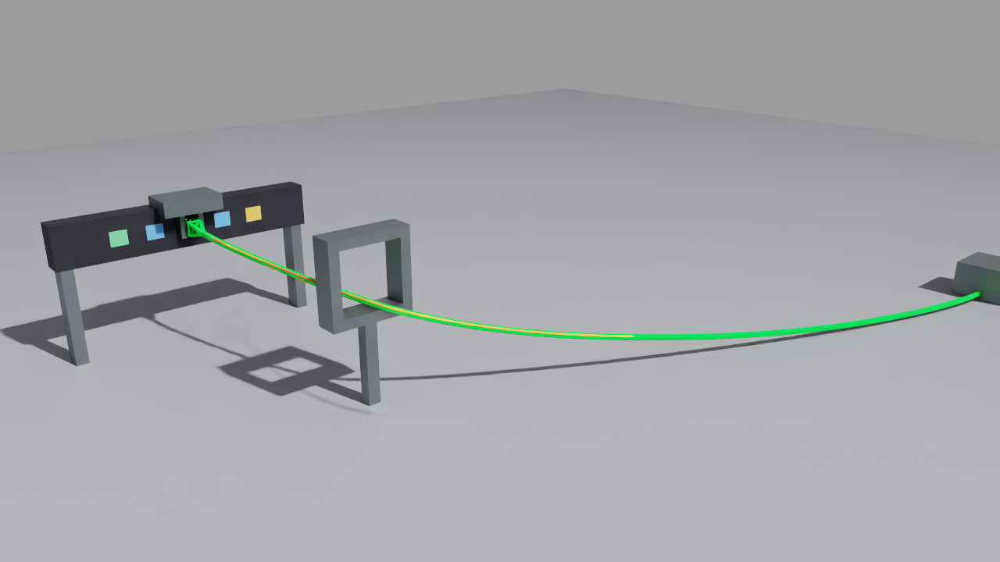

*Isaac Sim 6.2, RTX: a gripper has routed a Cat6 patch cable through a rack
D-ring into a patch-panel port. OpenBeam simulated the cable in every PhysX
step. The yellow and orange stretches are copper that yielded on the way.*

## Cables

A cable here is simulated, not animated. Nothing scripts its shape. A host
moves a gripper, a spool or a robot, and the cable's response is the physics:
how it sags, bends and twists, where it touches, the permanent set its copper
takes, and where it is damaged. The cable model runs inside the host's own
step, at about half real time on one CPU core for a 1 m patch cable. It needs
no offline finite-element run and no export. The checks below compare it with
beam theory.

### The cable model

[`assets/make_cable.py`](assets/make_cable.py) writes a cable from its data
sheet. It produces a JBeam lattice of cross-sections, 4 nodes each, joined
along the cable, and a `.materials` file that gives the lattice its physics:

- **Conductors.** The beams along the cable are copper, with a calibrated
  elastoplastic damage law (`ob_world_set_beam_material`). They yield past a
  set bend radius and harden. Damage begins at an accumulated plastic strain
  of 0.3 and they tear at 0.45, copper's ductility.
- **Jacket.** The diagonals and section braces stay elastic. They carry the
  share of the bending stiffness the cable's sizing gives them, and make the
  cable spring back.
- **Torsion.** A lattice of axial beams resists twist only through diagonals
  that lie nearly along its axis: 1 % of a real cable's GJ. Worse, a tightly
  bent bay can roll over to dodge bending its copper. Twist elements
  (`ob_world_add_rod_twist`, a `twist` line in `.materials`) supply the rest,
  as St-Venant torsion between neighbouring sections, the discrete-elastic-rod
  way. Each section receives an exact couple, so momentum is conserved.
- **Plug and boot.** `--rj45` ends the cable in an 8 g RJ45 plug. Its
  strain-relief boot tapers the jacket's bending stiffness from 3× at the plug
  to 1× over 40 mm.
- **Contact and damping.** Contact thickness is the cable's radius
  (`node_radius`), with friction estimated for PVC on laminate (0.5 static, 0.4 sliding). The
  cable's internal friction is a mass-proportional damping (`node_damping`).

| Property | Cat6 default | Source |
| --- | --- | --- |
| Diameter, mass | 6 mm, 43 g/m | Cat6 data sheets |
| Bending stiffness EI | 0.002 N·m² | an estimate for Cat6 UTP; measure yours (see [Calibration](#calibration)) |
| Rated minimum bend radius | 25 mm (4 diameters) | TIA-568; a performance rating, reported, never enforced |
| Torsion GJ | EI / 1.4 | an isotropic rod's; published cables span about 0.16 EI to 2.5 EI |
| Yield radius | 150 mm | an estimate until measured (see [Calibration](#calibration)) |
| Damage and break | 0.3 and 0.45 accumulated plastic strain | copper's ductility |
| Axial stiffness EA | 1600 N, effective | see below |

What is approximate, and how far:

- **EA is effective.** Real copper makes a cable nearly inextensible, which an
  explicit integrator follows only at a tiny step. With 1600 N the cable runs
  at a 33 µs step. One fibre strain sets both the bend radius at which the
  copper yields and the pull at which it yields in tension (EA r / R_yield). So
  this cable yields under about 20 N of pull, where a real Cat6's copper
  yields near its 110 N rated pulling tension. A route that pulls a cable taut
  is penalised early. Give a cable held at both ends some slack before moving
  it, as a technician would. To study pulling itself, use `--ea 51000`, which
  makes the two agree for Cat6, at the 5 µs step `make_cable.py` then prints.
- **The damage law's driver is accumulated plastic strain.** That is right for
  a monotonic overload but conservative for many small bends: by Coffin–Manson,
  copper survives about a hundred times more accumulated plastic strain at a
  1 % amplitude.
- **The lattice shears.** Its bays shear as well as bend, which costs 7 % of
  stiffness in a cantilever (below).
- **Resolution.** A bend much tighter than one section spacing (20 mm in the
  Cat6 cable) is beyond what the lattice resolves. The twist elements fade out
  in such kinks rather than push them apart.

### Validation

[`validation/`](validation/) holds a virtual bend-test machine. It grips a
cable and bends it under displacement control, as a pure-bending fixture does,
with the grip's torque as the load cell. Its results are compared with two
independent models: Euler–Bernoulli beam theory, and a fibre-section model of
the same section, which knows nothing of the 3-D lattice.

| Check | OpenBeam | Theory | Difference |
| --- | --- | --- | --- |
| Cantilever sag under its own weight, 0.14 m | 10.10 mm | 9.42 mm (w L⁴ / 8 EI) | +7.2 % (the lattice's bays also shear) |
| Peak moment, bent to R 300 mm (elastic) | 0.00648 N·m | 0.00653 N·m | −0.8 %; no set, as theory says |
| Peak moment, bent to R 70 mm (past yield) | 0.02146 N·m | 0.02176 N·m | −1.4 % |
| Permanent set after R 70 mm, unloaded | 311 mm | 314 mm | +1.0 % in curvature |
| Torque at 0.5 rad of twist | 0.003968 N·m | GJ θ / L = 0.003969 N·m | −0.02 %. The elements are sized from GJ, so this checks the implementation, not GJ |
| Coil memory in MuJoCo: wound round a 120 mm spool, let go on a desk | keeps a 243.8 mm coil | 242.4 mm (fibre model, free) | +0.6 % |

```bash
python -m pytest validation -q               # the first five rows, about 25 s (the coil: mujoco/tests)
python validation/bending_rig.py 0.08 0.05   # more bend radii, printed
```

<details>
<summary><b>Validation suite: 4 passed</b></summary>

```text
$ python -m pytest validation -v
validation/test_cable_physics.py::test_cantilever_sag_matches_euler_bernoulli PASSED
validation/test_cable_physics.py::test_bending_stiffness_and_no_set_below_yield PASSED
validation/test_cable_physics.py::test_permanent_set_matches_fibre_theory PASSED
validation/test_cable_physics.py::test_torsion_matches_st_venant PASSED
4 passed
```

</details>

### Calibration

Every number in the table can be measured on a real cable with simple
fixtures, and then set through `make_cable.py`:

- **EI:** clamp 0.3 m horizontally and measure the tip sag δ under its own
  weight w per metre: EI = w L⁴ / 8δ.
- **Yield radius:** wrap the cable once round mandrels of decreasing radius,
  let go, and measure the radius it keeps. The largest mandrel that leaves a
  set is the yield radius. Fit `--yield-radius` and `--hardening` until
  `bending_rig.py`'s fibre model gives the kept radii.
- **Damping:** pluck the clamped cable and time the decay. Amplitude falls as
  e^(−c t / 2), so `node_damping` c = 2 ln(A₁ / A₂) / Δt.
- **GJ:** twist 1 m by a known angle and read the torque: GJ = T L / θ.

## Cable demos

### MuJoCo: coil memory

[`mujoco/coil_demo.py`](mujoco/coil_demo.py): a motor-driven spool winds a
Cat6 cable about 330°, holds it, lets it go and sinks below the desk. An
identical cable beside it is never touched. Nothing bends the cable but the
spool. The coil it keeps is the copper's yield against the jacket's
spring-back and the desk's friction: 243.8 mm, where the fibre-section model
predicts 242.4 mm for a free cable. The untouched cable stays straight.

| Straight | Wound | Let go |
| --- | --- | --- |
| 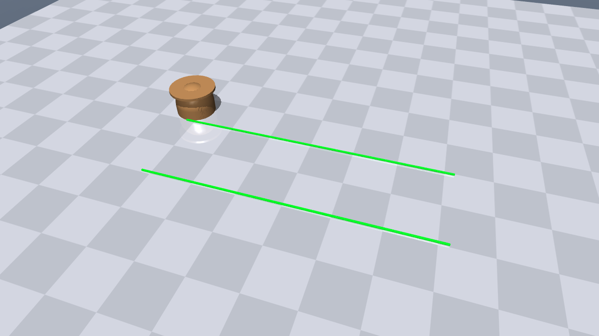 | 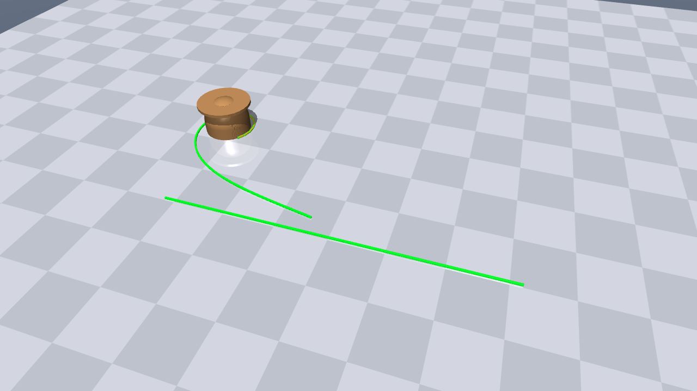 | 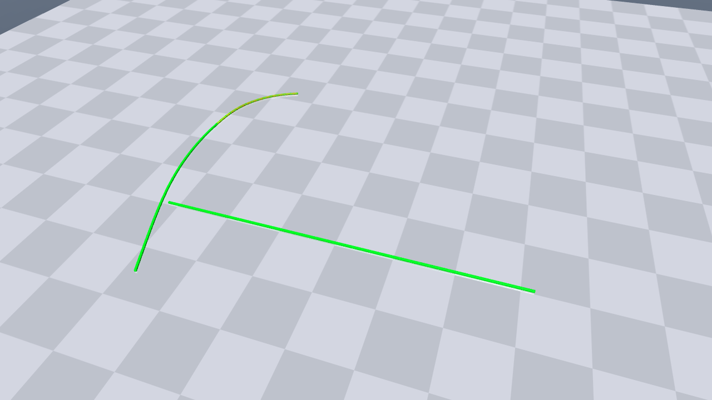 |

### MuJoCo: data-centre patching

[`mujoco/cable_demo.py`](mujoco/cable_demo.py): a mocap gripper takes a Cat6
cable's RJ45 plug and gives the cable some slack. It threads the cable through
a rack D-ring and pushes the plug into a patch-panel port. The run reports,
each kept apart:

- whether the cable threads the ring;
- the tightest bend and the time spent below the 25 mm rating;
- the set the copper took;
- any damage.

The gripper holds the plug rigidly, so the plug goes where the path takes it.
Where the cable goes is the physics.

| Through the ring | Plugged | Close-up: the copper that yielded |
| --- | --- | --- |
| 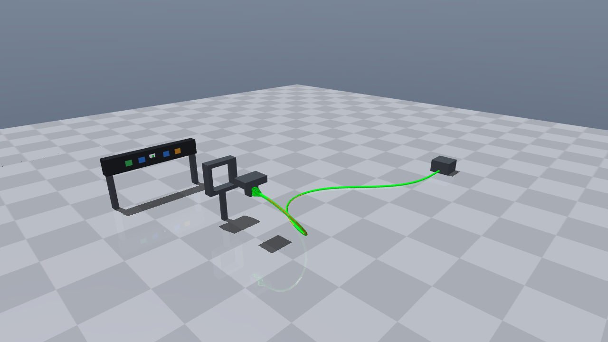 | 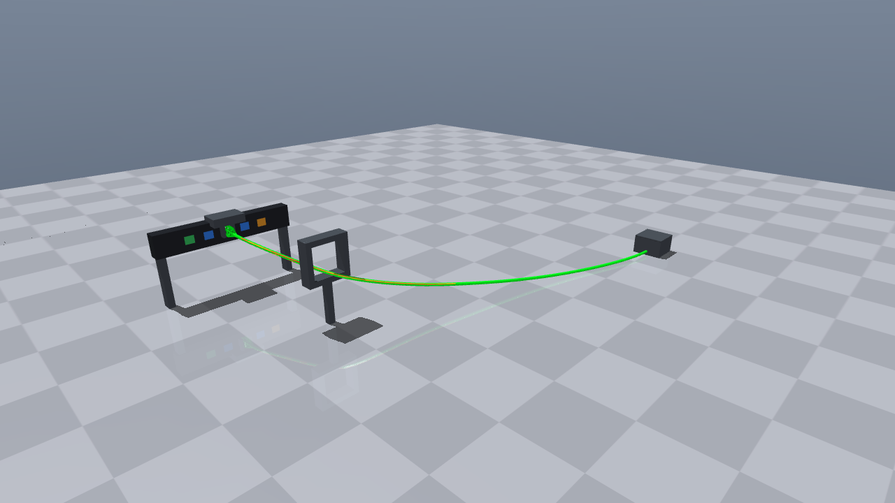 | 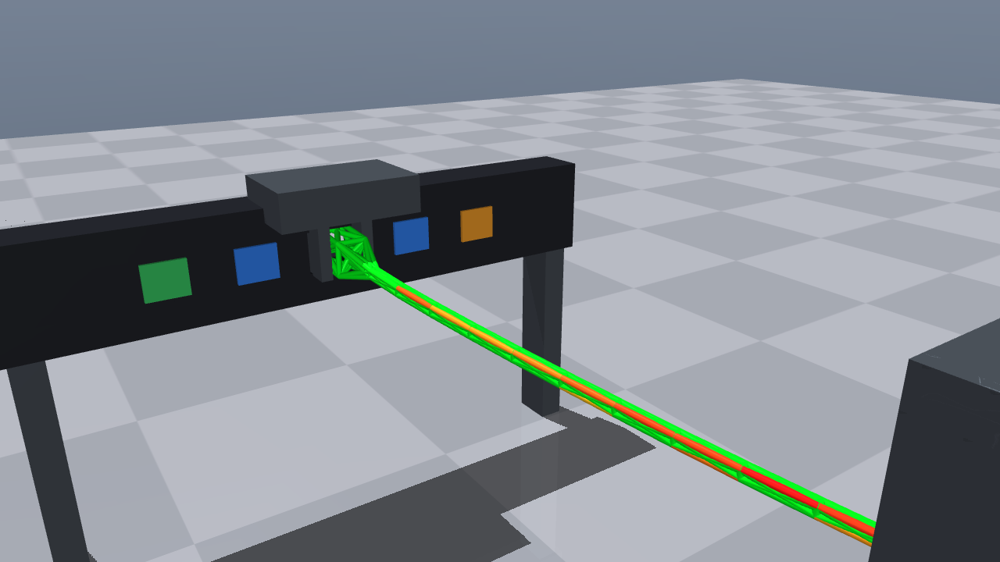 |

Two routes differ only in when the plug turns to face the port:

| Route | Threads ring | Tightest bend | Below rating | Conductor beams yielded | Peak plastic strain | Damage |
| --- | --- | --- | --- | --- | --- | --- |
| Turn while carrying (default) | yes | 39.0 mm | 0 s | 47 | 0.023 | none |
| Turn while lifting (`--turn-while-lifting`) | yes | 55.6 mm | 0 s | 23 | 0.021 | none |

A planner or a policy can use these as costs. The LeRobot environment below
does.

### Isaac Sim: the same patching, in PhysX and RTX

[`isaacsim/demo_isaacsim_cable.py`](isaacsim/demo_isaacsim_cable.py) builds the
same scene in a USD stage. The desk, outlet, D-ring, panel and gripper are
kinematic colliders, and the script drives the gripper along the same route
([`mujoco/cable_route.py`](mujoco/cable_route.py)). OpenBeam steps the cable in
every PhysX pre-step:

| Through the ring | Plugged |
| --- | --- |
| 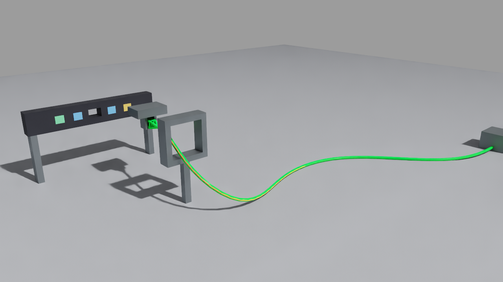 |  |

The same core and route in two hosts:

| Same route | Threads ring | Tightest bend | Yielded | Peak plastic strain | Damage | Speed |
| --- | --- | --- | --- | --- | --- | --- |
| MuJoCo, 2 ms step | yes | 38.95 mm | 47 | 0.0233 | none | 0.48× real time |
| Isaac Sim, 5 ms PhysX step | yes | 39.0 mm | 49 | 0.0231 | none | 0.37× real time |

```bash
<isaac-sim>/python.bat isaacsim/demo_isaacsim_cable.py --app physics      # headless, JSON summary
<isaac-sim>/python.bat isaacsim/demo_isaacsim_cable.py --app viewer --capture frames/
```

### LeRobot: a cable-routing environment

[`lerobot/openbeam_cable/`](lerobot/openbeam_cable/) is an EnvHub environment
built on the patching scene. The D-ring and the port move from episode to
episode. A speed-limited gripper takes a target position, yaw and grip.

- **Success:** the plug latches in the port with the cable through the ring
  and no conductor damaged.
- **Reward and info:** the bend rating and the set cost reward, and all three
  are in `info`.

Its scripted expert succeeds on the first twelve seeds. [The package
README](lerobot/openbeam_cable/README.md) gives the details.

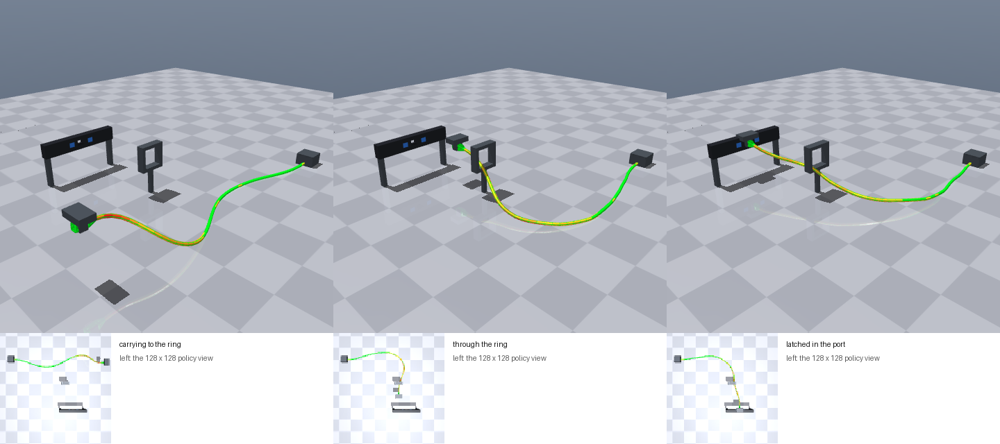

### Cables in your own scene

`make_cable.py` takes a cable's data. Its own `--help` gives every option.

```bash
python assets/make_cable.py --out my_cable.jbeam --length 1.5 --rj45
python assets/make_cable.py --out lc_fibre.jbeam --diameter 0.002 --mass-per-metre 0.0095 \
    --ei 0.0001 --ea 800 --min-bend-radius 0.0075 --yield-radius 0.05
```

In MuJoCo, the cable options are instance attributes. Hold or let go of nodes
from Python with the plugin's exported calls:

```xml
<instance name="cable">
  <config key="jbeam" value="my_cable.jbeam"/>
  <config key="materials" value="my_cable.materials"/>
  <config key="step" value="0.000033"/>           <!-- below the step make_cable.py printed -->
  <config key="node_radius" value="0.00118"/>     <!-- the contact radius it printed -->
  <config key="node_damping" value="6"/>
  <config key="friction" value="0.5 0.4"/>        <!-- static, sliding -->
  <config key="colliders" value="outlet grip ring"/>
  <config key="attach" value="s0_*:outlet s1_*:outlet"/>
  <config key="release" value="0.05"/>            <!-- s a grip takes to open -->
</instance>
```

```python
lib.openbeam_mujoco_attach(model._address, data._address, 0, b"rj_*", b"grip")   # weld the plug to a geom
lib.openbeam_mujoco_detach(data._address, 0, b"rj_*")                           # open the grip over `release`
```

A mocap body works as a gripper or spool. The plugin takes its velocity from
its pose one step back, so a cable it holds moves with it smoothly.

In Isaac Sim, the same options are `SoftBody` arguments. Kinematic colliders
are plain USD prims that your script or controller moves:

```python
cable = SoftBody("my_cable.jbeam", materials="my_cable.materials", step=33e-6, node_radius=0.00118,
                 node_damping=6.0, friction=(0.5, 0.4), kinematic_colliders=["/World/Gripper/Grip", "/World/Outlet"],
                 attach=[("s0_*", "/World/Outlet"), ("s1_*", "/World/Outlet")])
cable.attach("rj_*", "/World/Gripper/Grip")      # at the next physics step
cable.release("rj_*")                             # over release_seconds
```

## Build

| Needs | Windows | Linux |
| --- | --- | --- |
| C++17 compiler | Visual Studio 2022 or its Build Tools, with the x64 C++ tools | GCC or Clang |
| CMake | 3.24 or newer | 3.24 or newer |
| Ninja | optional | optional |
| Python | 3.12, for the scripts and tests | 3.12 |

Fetch the MuJoCo release the plugin builds against. It goes into
`third_party/mujoco-4.0.0` and is checked against its published SHA-256. Then
build:

```bash
python tools/fetch_mujoco.py
powershell -ExecutionPolicy Bypass -File build_windows.ps1
```

```bash
python3 tools/fetch_mujoco.py
./build_linux.sh
```

Each script configures `build/`, builds, installs to `build/install/` and runs
the core's tests:

| File | Windows | Linux |
| --- | --- | --- |
| The core, for the Isaac Sim extension | `build/install/bin/openbeam_core.dll` | `build/install/lib/libopenbeam_core.so` |
| The MuJoCo plugin, also used by LeRobot | `build/install/mujoco_plugin/openbeam_mujoco.dll` | `build/install/mujoco_plugin/libopenbeam_mujoco.so` |
| The C API | `build/install/include/openbeam_core.h` | the same |

Pass `-NoMujoco` (Windows) or `--no-mujoco` (Linux) to build the core alone,
or `-MujocoRoot` / `MUJOCO_ROOT=` to use another MuJoCo 4.0.0 release.

<details>
<summary><b>Core contract tests: passed</b></summary>

```text
$ ctest --test-dir build -C Release -V
rest: lowest node z=-0.00000 m, fastest node 0.00145 m/s
collider: cube momentum 289.6528 kg m/s, collider impulse -289.6529 N s, peak force 38503.2 N
legacy hang: stretch 0.002452 m (m g / k = 0.002452)
calibrated 245 N: deformed=1 broken=0 stretch=0.2210 m
calibrated 245 N: plastic strain 0.2177, damage 0.266
calibrated 1471 N: broke after 0.36 s
cable chain, 1 g nodes, 20000 N/m: fastest node 2.19e+23 m/s at 0.5 ms, 1.48 m/s at 0.05 ms
node radius 0.02 m: lowest node z=0.0200 m
attached node: z=2.0000 m (sphere at 2.2000), force on sphere -19.624 N
chain let go over 0.05 s at a 0.2 ms step: fastest node 2.46 m/s, 0 still attached
twist 0.3 rad: torque on the turned end -0.07264 N m with GJ/L = 0.2 N m/rad, -0.01264 N m without; roll 0.3000 rad
all openbeam_core checks passed
1/1 Test #1: openbeam_core_tests ..............   Passed    0.2 sec
100% tests passed out of 1
```

</details>

## MuJoCo: the plugin

Install MuJoCo's Python package, at the same version as the release whose
headers built the plugin:

```bash
python -m venv .venv
.venv/Scripts/python -m pip install mujoco==4.0.0 pytest pillow      # Linux: .venv/bin/python
.venv/Scripts/python mujoco/demo.py                  # headless, prints a JSON summary
.venv/Scripts/python mujoco/demo.py --viewer         # MuJoCo's interactive viewer
.venv/Scripts/python -m pytest mujoco/tests isaacsim/tests -q
```

The demo swings a 300 kg MuJoCo wrecking ball into
[`truss_crate.jbeam`](assets/truss_crate.jbeam), a 100-node, 603-beam crate.
`--frames DIR` writes PNG frames instead.

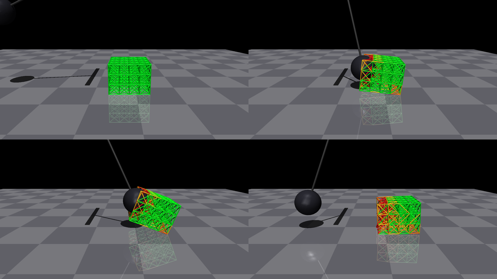

*`mujoco/demo.py --frames`, at 0.5, 1.1, 1.3 and 3.0 s. The plugin draws each
beam green to yellow by load, orange to red where it has yielded for good, and
a torn beam as two red stubs. The ball touches the crate at 1.034 s and stops
dead. The struck face caves in (51 beams torn, 290 yielded), and the crate
slides 0.62 m.*

<details>
<summary><b>MuJoCo plugin and cable demo tests: 11 passed</b></summary>

```text
$ python -m pytest mujoco/tests -v
mujoco/tests/test_cable_demos.py::test_mocap_grip_carries_the_cable_smoothly PASSED
mujoco/tests/test_cable_demos.py::test_coil_memory_matches_fibre_theory PASSED
mujoco/tests/test_cable_demos.py::test_patching_threads_the_ring_without_damage PASSED
mujoco/tests/test_openbeam_mujoco.py::test_plugin_registers_and_compiles PASSED
mujoco/tests/test_openbeam_mujoco.py::test_bad_jbeam_path_fails_model_creation PASSED
mujoco/tests/test_openbeam_mujoco.py::test_crate_rests_on_the_model_plane PASSED
mujoco/tests/test_openbeam_mujoco.py::test_two_way_coupling_conserves_momentum PASSED
mujoco/tests/test_openbeam_mujoco.py::test_one_advance_per_simulation_time PASSED
mujoco/tests/test_openbeam_mujoco.py::test_copy_and_reset PASSED
mujoco/tests/test_openbeam_mujoco.py::test_wrecking_ball_demo PASSED
mujoco/tests/test_openbeam_mujoco.py::test_drawing_shows_yield_and_tears PASSED
11 passed
```

</details>

To use the plugin in your own model, load it and declare an instance:

```python
mujoco.mj_loadPluginLibrary("build/install/mujoco_plugin/openbeam_mujoco.dll")
```

```xml
<extension>
  <plugin plugin="openbeam.softbody">
    <instance name="crate">
      <config key="jbeam" value="truss_crate.jbeam"/>   <!-- or an absolute path -->
      <config key="pos" value="0.45 -0.6 0.02"/>          <!-- placement of the JBeam origin -->
      <config key="quat" value="1 0 0 0"/>
      <config key="colliders" value="ball gripper_pad"/>  <!-- sphere/capsule/box geoms -->
      <config key="grounds" value=""/>                    <!-- plane geoms; empty = every plane -->
      <config key="stress_scale" value="2000"/>           <!-- N at full yellow in the drawing -->
      <config key="strain_scale" value="0.05"/>           <!-- plastic strain at full red -->
    </instance>
  </plugin>
</extension>
<sensor><plugin name="crate_state" instance="crate"/></sensor>
```

The sensor gives six values: beams broken, beams deformed, the centroid
(x, y, z) and the number of OpenBeam steps run. A relative `jbeam` path is
tried from the working directory first, then from `$OPENBEAM_ASSET_DIR`. For
MuJoCo's own `simulate` viewer, copy the plugin into the release's
`bin/mujoco_plugin/`, set `OPENBEAM_ASSET_DIR` to `assets/`, and open
`mujoco/models/wrecking_ball.xml`.

Coupling rules:

- OpenBeam advances inside the passive-force stage, once per simulation time.
  It advances on the first `mj_forward` at a new `d->time`. More forwards at
  that time, or the `mj_step` that integrates it, re-apply the same wrench
  without stepping again.
- Use the `Euler`, `implicit` or `implicitfast` integrator. RK4 evaluates
  forces at intermediate times and is not supported.
- `mj_resetData` resets the soft body. `mj_copyData` deep-copies it, so
  rollouts from a copy stay independent.
- `openbeam_mujoco_world(const mjData*, int instance)` is exported for hosts
  that want the full `ob_*` C API, such as the tests reading node velocities.

## Isaac Sim: the extension

The extension `openbeam.isaacsim.softbody` lives in
[`isaacsim/exts/`](isaacsim/exts/). It is pure Python: it calls the core
library through ctypes, so it needs no build against Kit and no Isaac Sim SDK.
It finds the library at `$OPENBEAM_CORE_DLL`, then in its own `bin/`, then in
this repository's `build/install/`.

Install Isaac Sim 6.2.0 from NVIDIA's standalone package and check its
[system requirements](https://docs.isaacsim.omniverse.nvidia.com/6.2.0/installation/requirements.html).
It asks you to accept the NVIDIA Omniverse License Agreement on first launch.
For an unattended run after you have accepted it, set `OMNI_KIT_ACCEPT_EULA=YES`
in that process's environment. `<isaac-sim>` below is the unpacked package.

```bash
<isaac-sim>/python.bat isaacsim/demo_isaacsim.py                      # headless, prints a JSON summary
<isaac-sim>/python.bat isaacsim/demo_isaacsim.py --gui                # window, real time
<isaac-sim>/python.bat isaacsim/demo_isaacsim.py --app viewer --capture crate.png
```

The demo registers `isaacsim/exts` with Kit's extension manager and enables
the extension. It builds the MuJoCo demo's scene: a PhysX ball on a revolute
pendulum and the same crate. It then steps PhysX at 200 Hz on the CPU pipeline.
`--app` picks the Kit app it runs in, and `--kit-arg=ARG` passes one more
argument to Kit, such as `--kit-arg=--/app/vulkan=false` for Direct3D 12:

| `--app` | App | Use |
| --- | --- | --- |
| `stock` (default) | Isaac's own Python app | The full Isaac Sim runtime. It needs the most memory |
| `viewer` | [`isaacsim/apps/openbeam.isaacsim.viewer.kit`](isaacsim/apps/openbeam.isaacsim.viewer.kit) | PhysX, the RTX renderer, a viewport, capture and menus, without the stock app's sensor, replicator and robotics extensions |
| `physics` | [`isaacsim/apps/openbeam.isaacsim.physics.kit`](isaacsim/apps/openbeam.isaacsim.physics.kit) | PhysX, the tensor API and the simulation manager, with no renderer or UI. Starts in about 5 s in about 1 GB |

In the full Isaac Sim app, add the extension folder and enable it. Open
**Window > OpenBeam > Wrecking Ball Demo**, then press Play:

```bash
<isaac-sim>/isaac-sim.bat --ext-folder <repo>/isaacsim/exts --enable openbeam.isaacsim.softbody
```

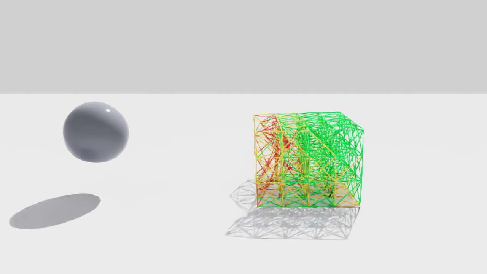

*The full Isaac Sim 6.2 GUI, after the GUI check below ran **Window > OpenBeam >
Wrecking Ball Demo** and 3 s of Play: the RTX viewport, which the check saves.
The PhysX ball has hit the OpenBeam crate and rebounded. The crate's beams are
drawn as curves: yellow under load, orange and red where they yielded, and red
stubs where they tore.*

<details>
<summary><b>Isaac Sim extension tests: 6 passed outside Isaac; 4/4, 5/5 and the GUI check inside it</b></summary>

```text
$ python -m pytest isaacsim/tests -v
isaacsim/tests/test_core_binding.py::test_crate_loads_and_rests PASSED
isaacsim/tests/test_core_binding.py::test_bad_path_raises PASSED
isaacsim/tests/test_core_binding.py::test_moving_collider_momentum_balance PASSED
isaacsim/tests/test_core_binding.py::test_reset_restores_digest PASSED
isaacsim/tests/test_core_binding.py::test_beam_damage_reports_yield_and_tears PASSED
isaacsim/tests/test_core_binding.py::test_cable_materials_add_twist PASSED
6 passed

$ <isaac-sim>/python.bat isaacsim/tests/isaac_coupling_check.py --app viewer
OPENBEAM_CHECK {"check": "extension_enabled", "ok": true, "id": "openbeam.isaacsim.softbody-0.2.0"}
OPENBEAM_CHECK {"check": "momentum_conserved", "ok": true, "crate_momentum": [532.64, 0.008418, -8.0444e-05], "ball_velocity": [2.2245, -2.8059e-05, 2.6555e-07], "total_error": [1.0014e-05, 2.9481e-07, -7.7992e-07]}
OPENBEAM_CHECK {"check": "wrecking_ball", "ok": true, "peak_speed": 7.645, "min_after_peak": 0.00044689, "beams_broken": 43, "beams_deformed": 297, "centroid_shift": [0.61661, 0.004319, -0.01532]}
OPENBEAM_CHECK {"check": "stop_resets", "ok": true}
OPENBEAM_CHECK {"check": "menu_action", "ok": true, "action_found": true, "scene_built": true, "max_beam_point_shift_m": 1.507}
OPENBEAM_CHECKS PASSED (5/5)

$ <isaac-sim>/python.bat isaacsim/tests/isaac_coupling_check.py --app physics
OPENBEAM_CHECKS PASSED (4/4)    (menu_action skipped: this app has no menus)

$ <isaac-sim>/isaac-sim.bat ... --exec isaacsim/tests/isaac_gui_smoke.py
OPENBEAM_GUI {"ok": true, "menu_entry": true, "menu_action": ["openbeam.isaacsim.softbody", "load_wrecking_ball_demo"], "action_registered": true, "sim_time_s": 3.017, "frames": 181, "max_beam_point_shift_m": 0.9959}
```

The momentum check sends a free 300 kg PhysX sphere at 4 m/s into the free
crate with gravity off. Ball and crate momentum together stay at 1200 kg m/s,
to within 1.1e-5.

</details>

From Python, in any stage:

```python
from openbeam.isaacsim.softbody import SoftBody
crate = SoftBody("assets/truss_crate.jbeam", position=(0.45, -0.6, 0.02),
                 colliders=["/World/Ball"], ground_height=0.0)
```

Coupling rules:

- OpenBeam advances in `SimulationEvent.PHYSICS_PRE_STEP`, by the physics dt,
  in 0.5 ms steps (the remainder carries). The wrench goes to the collider
  bodies through `apply_forces_and_torques_at_position` for the step PhysX
  takes next.
- Colliders are rigid-body prims that are, or have as a direct child, a
  `UsdGeom` Sphere, Cube or Capsule with axis Z, centred on the body origin.
  The origin is taken as the centre of mass. The ground is a plane at
  `ground_height`.
- Kinematic colliders (`kinematic_colliders=`) are prims of the same shapes
  that the host moves by their USD transform. OpenBeam takes each one's
  velocity from its pose one physics step back, and nothing acts back on it.
  Use them for grippers, spools and fixed scenery: a light PhysX body stiffly
  coupled to a cable would need a much smaller PhysX step to stay stable.
- Stopping the timeline resets the soft body to its rest pose.
- Isaac's first physics step at Play runs before the tensor views exist. On
  that one step OpenBeam does not advance.

Memory: Isaac Sim 6.2 asks for 32 GB of RAM. The first start of an RTX app
compiles the ray-tracing pipelines in the driver. That took about 2.5 min,
with Kit at about 10.5 GB. On a 16 GB machine, close other applications first.
The driver caches the result, so later starts are quick.

## LeRobot: the soft-box push

Besides the cable-routing environment above,
[`lerobot/openbeam_push/`](lerobot/openbeam_push/) is a LeRobot EnvHub
package. Its `env.py` exposes `make_env(n_envs, use_async_envs, **kwargs)` and
`LEROBOT_SIM`, the API that LeRobot loads environments through. In the task, a
position-controlled pusher (a MuJoCo capsule) pushes a 4.8 kg JBeam box
(`soft_box.jbeam`, 48 nodes, 254 beams) onto a goal. OpenBeam simulates the
box through the MuJoCo plugin. An episode succeeds when the box reaches the
goal undamaged. A steady push moves it cleanly, and a strike at speed dents it.
[The package README](lerobot/openbeam_push/README.md) gives the observations,
actions and options.

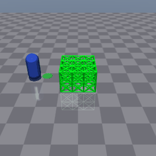

*The scripted expert on two seeds. It goes round the box and pushes it onto
the green goal, stopping within 5 cm with no beam yielded. Below, the side
camera of `render()`, and the 96 × 96 top-camera image that LeRobot gives a
policy as `observation.image`.*

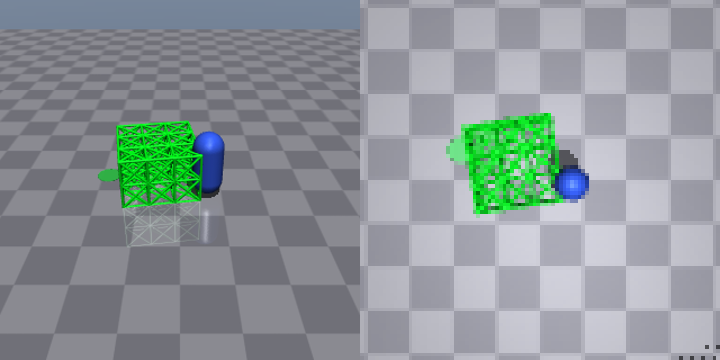

<details>
<summary><b>LeRobot environment tests: 22 passed</b></summary>

```text
$ python -m pytest lerobot/tests -v
lerobot/tests/test_openbeam_cable.py::test_gymnasium_env_checker[state] PASSED
lerobot/tests/test_openbeam_cable.py::test_gymnasium_env_checker[pixels_state] PASSED
lerobot/tests/test_openbeam_cable.py::test_reset_is_deterministic_and_moves_the_ring_and_port PASSED
lerobot/tests/test_openbeam_cable.py::test_expert_routes_the_cable_and_latches_the_plug_undamaged[0] PASSED
lerobot/tests/test_openbeam_cable.py::test_expert_routes_the_cable_and_latches_the_plug_undamaged[1] PASSED
lerobot/tests/test_openbeam_cable.py::test_expert_routes_the_cable_and_latches_the_plug_undamaged[2] PASSED
lerobot/tests/test_openbeam_cable.py::test_skipping_the_ring_does_not_succeed PASSED
lerobot/tests/test_openbeam_cable.py::test_lerobot_hub_env_config_loads_and_steps PASSED
lerobot/tests/test_openbeam_cable.py::test_lerobot_runs_the_expert_to_success PASSED
lerobot/tests/test_openbeam_push.py::test_gymnasium_env_checker[state] PASSED
lerobot/tests/test_openbeam_push.py::test_gymnasium_env_checker[pixels_state] PASSED
lerobot/tests/test_openbeam_push.py::test_box_rests_and_reset_is_deterministic PASSED
lerobot/tests/test_openbeam_push.py::test_expert_pushes_box_onto_goal_undamaged[0] PASSED
lerobot/tests/test_openbeam_push.py::test_expert_pushes_box_onto_goal_undamaged[1] PASSED
lerobot/tests/test_openbeam_push.py::test_expert_pushes_box_onto_goal_undamaged[2] PASSED
lerobot/tests/test_openbeam_push.py::test_expert_pushes_box_onto_goal_undamaged[3] PASSED
lerobot/tests/test_openbeam_push.py::test_expert_pushes_box_onto_goal_undamaged[4] PASSED
lerobot/tests/test_openbeam_push.py::test_expert_pushes_box_onto_goal_undamaged[5] PASSED
lerobot/tests/test_openbeam_push.py::test_ramming_dents_the_box PASSED
lerobot/tests/test_openbeam_push.py::test_contact_couples_both_ways PASSED
lerobot/tests/test_openbeam_push.py::test_lerobot_hub_env_config_loads_and_steps PASSED
lerobot/tests/test_openbeam_push.py::test_lerobot_runs_the_expert_to_success PASSED
22 passed
```

</details>

```bash
python -m venv .venv-lerobot
.venv-lerobot/Scripts/python -m pip install lerobot==0.7.0 mujoco==4.0.0 pytest
.venv-lerobot/Scripts/python -m pytest lerobot/tests -q
```

On Linux, add `--extra-index-url https://download.pytorch.org/whl/cpu` to get
a CPU-only torch instead of the CUDA build. From the repository root:

```python
from lerobot.envs.configs import HubEnvConfig
envs = HubEnvConfig(hub_path="lerobot/openbeam_push", trust_remote_code=True).create_envs(n_envs=4)
env = envs["hub_env"][0]  # observation.image (96x96 RGB) and observation.state (pusher x, y)
```

`trust_remote_code=True` lets LeRobot execute `env.py`. On Windows, with
LeRobot 0.7.0:

- Give `hub_path` as a relative path. LeRobot splits it at the first `:`, so a
  drive path such as `D:/...` is read as a Hub repository.
- `use_async_envs=True` fails. LeRobot starts its env workers with
  multiprocessing's `forkserver` method, which Windows does not have. Use
  synchronous envs.

Pixel observations need OpenGL. On a headless Linux machine, set
`MUJOCO_GL=egl` or `MUJOCO_GL=osmesa`.

## Tests

| Suite | Command | Needs | In CI |
| --- | --- | --- | --- |
| Core contract tests | `build_windows.ps1` / `build_linux.sh` (CTest) | a C++ compiler | Windows, Linux |
| MuJoCo plugin and cable demos (11) | `python -m pytest mujoco/tests` | `mujoco==4.0.0` | Windows, Linux |
| Isaac extension binding (6) | `python -m pytest isaacsim/tests` | NumPy | Windows, Linux |
| Cable physics validation (4) | `python -m pytest validation` | NumPy | Windows, Linux |
| Isaac extension in Isaac Sim (5) | `<isaac-sim>/python.bat isaacsim/tests/isaac_coupling_check.py --app physics` (or `viewer`, `stock`) | Isaac Sim 6.2 | no |
| Isaac extension in the GUI | see below | Isaac Sim 6.2, an RTX GPU | no |
| LeRobot environments (22) | `python -m pytest lerobot/tests` | `lerobot==0.7.0`, `mujoco==4.0.0`; OpenGL for 4 pixel tests | Windows (without the pixel tests), Linux |

What each covers:

- **Core:** JBeam loading; free fall against the closed form; rest on a plane;
  collider impulse equal to −Δ(momentum); classic break and static stretch
  m g/k; calibrated yield and fracture; `breakGroup`; clone and reset digests;
  placement; the step a stiff chain needs; node radius; a weld's exact
  reaction; a grip that opens without destabilising a chain at 90 % of its
  stability limit; twist torque and roll.
- **MuJoCo plugin:** registration; a bad path refused; rest; two-way momentum
  with a free MuJoCo sphere (0.1 % bound); one advance per simulation time;
  `mj_copyData` and `mj_resetData`; the wrecking ball; yield and tears drawn; a
  mocap grip carrying a cable smoothly; coil memory within 10 % of the fibre
  model with no bay rolled over; the patching route threading the ring,
  undamaged.
- **Isaac extension, outside Isaac:** the ctypes binding: load and rest, a bad
  path, momentum, reset digests, damage readout, a cable's twist elements.
- **Cable validation:** cantilever sag, elastic bending with no set, the set
  past yield, and torsion, each against theory (see [Validation](#validation)).
- **Isaac extension, inside Isaac:** Kit enables it; momentum against a free
  PhysX sphere (0.1 %); the wrecking ball; stop resets; the Window menu action
  builds the scene, and the crate moves after Play.
- **LeRobot environments:** for each, Gymnasium's env checker, seeded resets,
  the scripted expert succeeding undamaged, and LeRobot's `HubEnvConfig`
  loading, stepping and running the expert to success. The push task also has
  ramming denting the box and two-way contact. The cable task also has a
  route that skips the ring failing.

The GUI check runs inside the full app. It finds the menu entry, runs it,
plays 3 s, saves the viewport to `$OPENBEAM_GUI_CAPTURE` and quits:

```bash
<isaac-sim>/isaac-sim.bat --ext-folder <repo>/isaacsim/exts --enable openbeam.isaacsim.softbody --/app/file/ignoreUnsavedOnExit=true --exec <repo>/isaacsim/tests/isaac_gui_smoke.py
```

## Verification record (2026-11-07)

One Windows 11 laptop: Ryzen 7 5800H, 16 GB RAM, RTX 3070 Laptop with 8 GB,
NVIDIA driver 555.99, MSVC 14.44. MuJoCo 4.0.0, Isaac Sim 6.2.0
(`6.2.0-rc.14+release.52805.02189a84.gl`, standalone package), LeRobot 0.7.0
with torch 2.15.0 (CPU) and gymnasium 1.4.0.

| Check | Result |
| --- | --- |
| Core, MuJoCo, Isaac binding and LeRobot suites | All passed |
| `isaac_coupling_check.py`, `physics` and `viewer` (RTX) apps, extension 0.2.0 | 4/4 and 5/5. The menu action built the scene, and the crate's beams moved up to 1.5 m |
| `isaac_gui_smoke.py` in the full GUI, extension 0.2.0 | Passed: the menu entry is bound to the extension's action; the crate's beams moved up to 1.0 m in 3 s; the viewport was saved |
| Wrecking ball, MuJoCo vs Isaac Sim | Contact at 1.034 s vs 1.025 s. Ball 7.66 vs 7.64 m/s at impact, stopped by the crate in both. 51 vs 43 torn and 290 vs 297 yielded beams; the crate slides 0.62 m in both |
| Push task, scripted expert, 50 seeds | 50/50 successes, no beam yielded, 73 steps median (106 max) |
| Cable validation (validation/) | Set after bending to 70 mm within 1.0 % of the fibre model; moment within 1.4 %; sag +7.2 % |
| Coil memory, MuJoCo | Kept a 243.8 mm coil; the fibre model gives 242.4 mm |
| Patching, MuJoCo vs Isaac Sim (`physics` and `viewer` apps) | Both thread the ring; tightest bend 38.95 vs 39.0 mm; 47 vs 49 beams yielded; no damage in either |
| Cable task, scripted expert, 12 seeds | 12/12 latched with the cable through the ring, no damage, tightest bend 50 to 55 mm |

Not verified:

- The cable's properties on a real cable. EI, the yield radius, GJ, damping
  and friction are the estimates listed in [The cable model](#the-cable-model)
  until someone measures them ([Calibration](#calibration)).
- Isaac Sim on its required driver, 595.97 or newer.
- Using the Isaac Sim GUI by hand: the menu entry was run by script.
- Training or evaluating a policy on either task (`lerobot-train`,
  `lerobot-eval`), LeRobot's env server, and publishing to the Hub.
- The cable demo in the full Isaac Sim GUI: it ran in the `physics` and
  `viewer` apps.
- The GPU (`cuda`) PhysX pipeline.
- Linux beyond CI, and macOS.

## Roadmap

Each item extends what is here without changing it:

- **A compliant grip** (a grip of finite stiffness), so that whether a plug
  seats in a port is the physics too.
- **Cyclic damage**, a fatigue driver for the damage law, for cables flexed
  many times.
- **Stiffer cables at speed:** an implicit or GPU-batched core, so that real
  EA and finer lattices run in real time.
- **Measured cable libraries:** Cat6, Cat6A, fibre and power cords, calibrated
  with the procedure above.
- **Hosts:** MuJoCo Warp and MJX run no engine plugins, so the core would need
  a port to reach them; Isaac Sim's GPU PhysX pipeline is untested.

## Licence

[LICENSE.md](LICENSE.md) gives the details:

- **Code:** GPL-3.0-or-later ([COPYING](COPYING)). The vendored law sources in
  `third_party/openbeam/` are GPL-3.0 version 3 only, so the built libraries are
  GPL-3.0. You may use, change and run everything, commercially too. If you
  distribute it, or a product that includes it, you must share that source
  under the GPL as well.
- **Assets:** the JBeam structures and the images in `docs/images/` are
  CC BY 4.0, so you may reuse them anywhere if you credit them.
- **Name:** the licences grant no rights in the OpenBeam name or logos.
- **Contributions:** contributors sign the [OpenBeam CLA](CLA.md); see
  [CONTRIBUTING.md](CONTRIBUTING.md).

MuJoCo and LeRobot are Apache-2.0, and Isaac Sim is under NVIDIA's licence.
This repository includes none of them.

### The vendored OpenBeam sources

[`tools/vendor_openbeam.py`](tools/vendor_openbeam.py) copies the 22 files the
core compiles from an OpenBeam checkout, as committed at its HEAD.
[`SOURCES.json`](third_party/openbeam/SOURCES.json) records their SHA-256 and
the commit each was last changed in. CI runs `--check`, which fails when a copy
no longer matches that record:

```bash
python tools/vendor_openbeam.py --from <openbeam checkout>
python tools/vendor_openbeam.py --check
```
