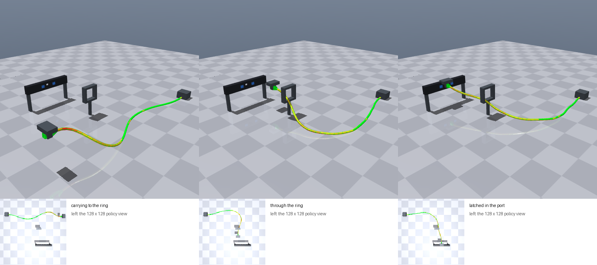

# OpenBeam cable routing

A [LeRobot](https://github.com/huggingface/lerobot) EnvHub environment for
data-centre cable work. A gripper routes a 1 m Cat6 patch cable from a wall
outlet through a rack D-ring and plugs it into a patch-panel port. The cable is
an [OpenBeam](../../README.md) structure simulated through MuJoCo's
`openbeam.softbody` engine plugin, and the cable's behaviour is the physics:

- Its copper conductors yield and take a permanent set.
- The jacket is elastic, and the cable resists twist.
- The RJ45 plug weighs its real 8 g and has a strain-relief boot.
- The cable touches the desk, the ring and the panel.



| | |
| --- | --- |
| Scene | A desk, a wall outlet at (−0.30, 0.25), a D-ring at x 0.18 to 0.30, and a 1U patch panel whose open port lies 6 cm left to 8 cm right of the ring. Every route leaves at least 6 cm of the cable as slack. MuJoCo 4.0 runs at a 2 ms step and OpenBeam at 33 µs. |
| Cable | `cat6_cable.jbeam` and `cat6_cable.materials`, from the repository's `assets/make_cable.py`. Their properties are listed in [Cable model](#cable-model). |
| Gripper | A mocap body that moves towards the action's target at up to 0.4 m/s and 3 rad/s. Closing it takes the plug if the plug is within 15 mm. |
| Control | 20 Hz. An episode lasts at most 200 steps (10 s). |
| Action | `Box((5,))`: target x, y, z in metres, yaw in radians, and grip (above 0.5 closes it) |
| Success | The plug latches in the port, with the cable through the ring and no conductor damaged. The episode then terminates. |
| Failure | Any conductor damaged: the episode terminates. |
| Reward | −(distance from the plug to its seat) − 0.5 while the cable is bent below its rated radius − 0.002 × (yielded conductor beams) − 1 once damaged |

The latch is a rule, as an RJ45's is a catch. Once the gripper has pushed the
plug 12 mm or more into the port, within 2 mm of its axis and square to the
panel, the panel holds the plug and the gripper lets go. Everything about the
cable on the way is simulated, not scripted:

- whether the cable passes through the ring;
- how it bends;
- the set its copper takes.

## Observations

`make_env(obs_type=...)`, or `make_env_kwargs={"obs_type": ...}` through
LeRobot:

| `obs_type` | Keys | LeRobot features |
| --- | --- | --- |
| `pixels_agent_pos` (default) | `pixels` (128 × 128 × 3 uint8, top camera) and `agent_pos` (gripper x, y, z, yaw, grip) | `observation.image`, `observation.state` |
| `state` | `agent_pos` and `environment_state` (48 values; listed below) | `observation.state`, `observation.environment_state` |
| `pixels_state` | All three | All three |

`environment_state` holds, in order:

- the plug's centre (3) and its axis (3);
- the ring's centre (3);
- the port's mouth (3);
- 11 points along the cable (33);
- the yielded and damaged conductor beams;
- whether the plug has latched.

Other options are `observation_size` (default 128), `render_size` (the side
camera of `render()`, default 384) and `max_episode_steps` (default 200).

`info` carries what a planner or a reviewer of a policy needs, each kept apart:

- `is_success`, `latched` and `threads_ring`;
- the plug's offset from the port axis and its insertion, in mm;
- `tightest_bend_radius_mm` and `time_below_rating_s`. The rating is Cat6's
  25 mm minimum bend radius, a performance rating rather than a failure.
- `beams_yielded` and `peak_plastic_strain`, the permanent set;
- `beams_damaged` and `beams_torn`, where the copper's ductility ran out.

## Cable model

The cable lattice comes from `make_cable.py` with Cat6 data:

- 6 mm diameter, 43 g/m, and EI 0.002 N·m².
- **Torsion:** GJ = EI / 1.4, an isotropic rod's.
- **Copper:** yields past a 150 mm bend radius, an estimate until measured. Its
  damage starts at an accumulated plastic strain of 0.3 and it tears at 0.45.
- **Axial stiffness:** effective EA = 1600 N. With it, the conductors yield
  under about 20 N of pull, where a real Cat6's copper yields near its 110 N
  rated pulling tension. A route that pulls the cable taut is therefore
  penalised early. The repository README explains the trade-off and how to
  raise EA for pulling studies.
- **Damage law:** its driver is accumulated plastic strain, which is
  conservative for repeated small bends. That is one reason the RJ45's boot
  matters: without it, bends concentrate where the cable meets the rigid plug.

## Use

Install `mujoco==4.0.0` and `lerobot` (`requirements.txt`). Build the plugin
(`openbeam_mujoco.dll`, or `libopenbeam_mujoco.so` on Linux) with this
repository's `build_windows.ps1` or `build_linux.sh`. `env.py` finds it at
`$OPENBEAM_MUJOCO_PLUGIN`, next to `env.py`, or in the repository's
`build/install/mujoco_plugin/`. Then, from the repository root:

```python
from lerobot.envs.configs import HubEnvConfig

envs = HubEnvConfig(hub_path="lerobot/openbeam_cable", trust_remote_code=True).create_envs(n_envs=2)
env = envs["hub_env"][0]
obs, info = env.reset(seed=[0, 1])
```

On Windows, give `hub_path` as a relative path: LeRobot splits it at the first
`:`. Also keep `use_async_envs=False`: LeRobot 0.7.0 starts its workers with
the `forkserver` method, which Windows does not have. An episode runs at about
half real time on one CPU core.

`OpenBeamCableEnv.expert_action()` is a scripted expert for demonstrations. It
works in five moves:

1. It takes the plug and slides it back and aside to give the cable slack.
2. It lifts the plug.
3. It carries it through the ring, turning it to face the port.
4. It goes on until the cable behind runs straight through the ring.
5. It pushes the plug into the port, correcting for where the plug's front
   actually is.

On the first twelve seeds it latches the plug every time, with the cable
through the ring, no damage, and the tightest bend 50 to 55 mm.

## Licence

`env.py` is GPL-3.0-or-later, and so is the plugin library it loads.
`cat6_cable.jbeam` and `cat6_cable.materials` are generated by `make_cable.py`
and are CC BY 4.0. See the repository's LICENSE.md.
